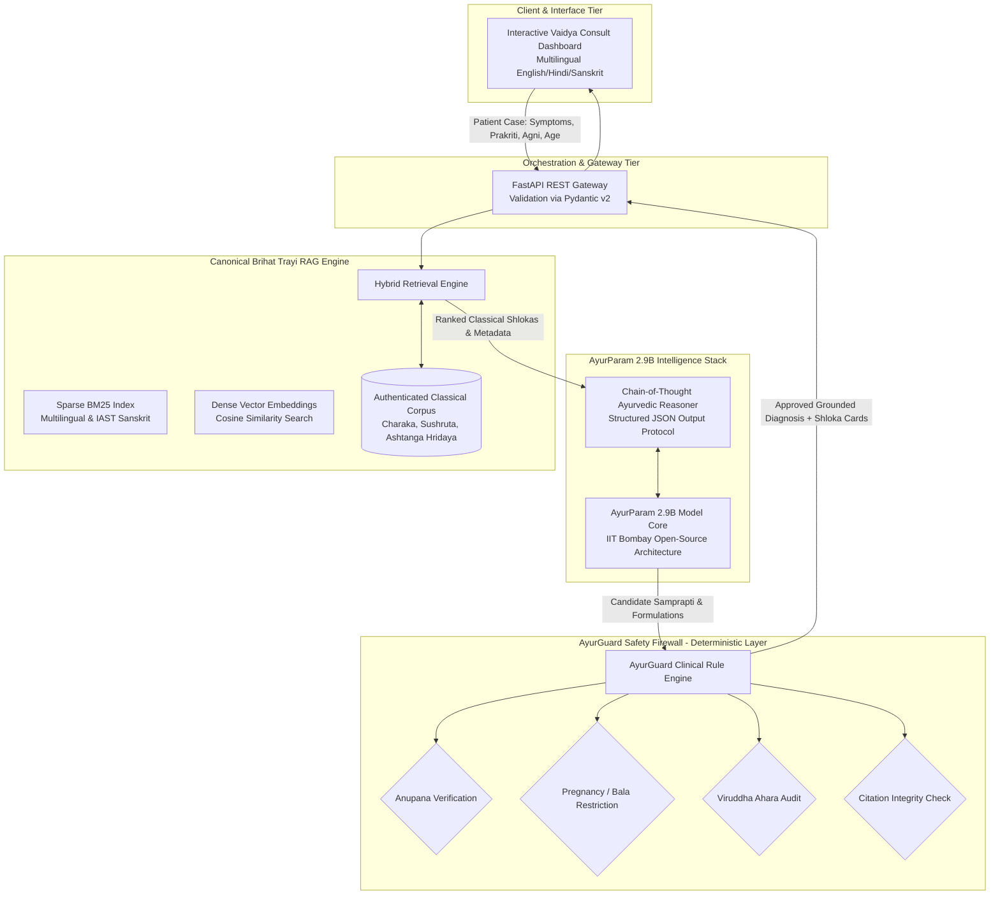

# AyurSetu: Source-Grounded Clinical Decision Support & Classical Knowledge Retrieval System
**AyushTech Innovate: National Open Ayurveda AI Challenge 2026–27**  
*Organized by Techfest, IIT Bombay in collaboration with the Ministry of Ayush & All India Institute of Ayurveda (AIIA)*

---

## Technical & Clinical Grounding Proposal (Phase 1 Submission)

**Project Title:** AyurSetu (आयुर्सेतु) — The Bridge Between Classical Brihat Trayi Wisdom and Safe Clinical AI  
**Track:** Clinical & Practitioner Intelligence / Academic & Research Knowledge Systems  
**Core LLM Engine:** AyurParam (IIT Bombay's Open-Source 2.9B Ayurveda Model)  
**Open-Source License:** MIT License  
**Repository Structure:** Modular Python (FastAPI + Pydantic v2) + Hybrid RAG (BM25 + Dense) + AyurGuard Deterministic Safety Firewall  

---

## 1. Executive Summary & Clinical Problem Formulation

### 1.1 The Clinical & Academic Bottleneck
Ayurveda is an evidence-backed system of holistic medicine governed by multi-factorial diagnostic logic (*Trisutra*: *Hetu*, *Linga*, *Aushadha*) and personalized constitutional analysis (*Prakriti*, *Agni*, *Koshtha*, *Dhatu*, *Srotas*). However, in modern clinical and academic environments, Vaidyas (practitioners) and BAMS/MD students face three critical challenges:

1. **Information Overload & Granular Shloka Retrieval Friction**:
   The *Brihat Trayi* (Charaka Samhita, Sushruta Samhita, and Ashtanga Hridaya) comprises over 20,000 verses. Correlating a patient's complex symptom clusters (*Lakshana-samucchaya*) with the classical etiopathogenesis (*Samprapti*) and locating the authentic source verse (*Sthana*, *Adhyaya*, and *Shloka*) currently requires extensive manual cross-referencing. During high-volume outpatient department (OPD) hours, this often leads to empirical shortcuts rather than treatise-grounded care.

2. **Severe Hallucination & Lethal Risks of Generalist AI**:
   When general-purpose Large Language Models (LLMs) are queried for Ayurvedic guidance, they routinely:
   - Hallucinate classical citations (fabricating verse numbers in Charaka or Sushruta).
   - Omit essential adjuvants (*Anupana*), without which herbal formulations can be ineffective or harmful.
   - Recommend drastic purification procedures (*Shodhana* such as *Virechana* or *Vamana*) or toxic mineral preparations (*Rasa Shastra*) to vulnerable demographics (pregnant women, infants, or the frail elderly).

3. **Absence of Deterministic Contraindication Guardrails**:
   Ayurvedic pharmacology (*Dravyaguna*) operates under strict rules of *Viruddha Ahara* (incompatible food combinations) and seasonal adjustments (*Ritucharya*). Probabilistic neural networks cannot be trusted to enforce these rules without a deterministic, rule-based verification layer.

### 1.2 The AyurSetu Solution
**AyurSetu** is an open-source, source-traceable Clinical Decision Support System (CDSS) and Classical Retrieval Engine engineered around **AyurParam (2.9B)**. AyurSetu guarantees **source verifiability** and **clinical safety** through three pillars:
- **Shloka-Level Canonical RAG**: Every clinical insight, disease correlation, and formulation recommendation is anchored to authentic *Brihat Trayi* verses with immutable identifiers (`[Treatise, Sthana, Adhyaya, Shloka]`).
- **Automated Samprapti Modeling Engine**: Structures patient diagnostic workflows from *Hetu* (etiology) to *Dosha-Dushya Sammurchhana* (pathology progression) to *Chikitsa Sutra* (treatment principles).
- **AyurGuard Deterministic Safety Firewall**: An independent, rule-based clinical validation layer that audits every prescription for *Anupana* compatibility, pregnancy (*Garbhini*), pediatric (*Bala*), and seasonal (*Ritucharya*) restrictions before rendering.

---

## 2. System Architecture & Engineering Stack



### 2.1 Architectural Components

1. **Multilingual Diagnostic Intake**:
   Accepts clinical chief complaints, constitutional parameters (*Prakriti*, *Agni*, *Koshtha*), demographic details (age, pregnancy, lactation), and current season (*Ritu*).
2. **Hybrid Canonical RAG Engine**:
   - Indexes canonical verses in both Devanagari Sanskrit and IAST (International Alphabet of Sanskrit Transliteration) Roman script.
   - Employs hybrid sparse-dense retrieval ($BM25 + \text{Cosine Similarity}$) with domain-weighted boosting for clinical keywords, indications, and classical formulations.
3. **AyurParam 2.9B Reasoning Core**:
   - Receives the retrieved classical contexts and patient parameters within a constrained clinical prompt template.
   - Generates structured *Samprapti Ghatakas* (Dosha, Dushya, Agni, Ama, Srotas, Sroto-dushti, Adhisthana) and *Chikitsa Sutra*.
4. **AyurGuard Deterministic Firewall**:
   - Acts as a zero-trust intermediary outside the LLM.
   - Evaluates prescriptions against the certified *Formulation Safety Catalog* and *Viruddha Ahara Matrix*.
   - Rejects or flags unverified vehicles, dangerous drug combinations, and unauthorized shloka citations.

---

## 3. AyurParam 2.9B Model Integration & In-Context Grounding

### 3.1 Model Utilization & Optimization
AyurParam (IIT Bombay’s open-source 2.9B parameter language model) is trained specifically on Indian medical and Ayurvedic corpora. AyurSetu integrates AyurParam via two complementary deployment paths:
- **Local Edge / On-Premise Deployment**: Runnable via `vLLM` or `Ollama` quantized to 4-bit/8-bit (GGUF/AWQ), requiring under 4GB VRAM. This enables rural clinics and standalone Ayurvedic hospitals without continuous high-speed internet to operate fully offline.
- **Structured JSON Schema Enforcement**: Utilizing constrained decoding (via Pydantic schemas) to guarantee that model outputs strictly adhere to the `ClinicalDiagnosticResponse` format without extraneous preamble or conversational drift.

### 3.2 Clinical Chain-of-Thought (CoT) Prompt Template
The reasoning prompt constrains AyurParam to authentic classical terminology:
```text
[SYSTEM: CLINICAL AYURVEDIC REASONER - AYURPARAM 2.9B]
You are AyurParam, an expert Vaidya clinical assistant.
You are provided with verified excerpts from the Brihat Trayi:
{RETRIEVED_CLASSICAL_SHLOKAS}

PATIENT PROFILE:
- Age: {age}, Gender: {gender}, Pregnancy: {is_pregnant}
- Prakriti: {prakriti}, Agni: {agni}, Koshtha: {koshtha}
- Chief Complaints: {chief_complaints}
- Current Ritu (Season): {current_season}

TASK:
1. Formulate Roganirnaya (probable Vyadhi).
2. Deconstruct the Samprapti Ghatakas (Dosha, Dushya, Agni, Ama, Srotas, Sroto-dushti, Adhisthana).
3. State the governing classical Chikitsa Sutra citing the exact verse.
4. Recommend classical formulations with mandatory Anupana, dosage, and Kala.
5. Provide Pathya (wholesome) and Apathya (unwholesome) regimens.
CRITICAL RULE: Do not prescribe any formulation without citing its authentic shloka_id from the retrieved context.
```

---

## 4. Source-Grounding & Shloka-Level Traceability Pipeline

### 4.1 Classical Corpus Ingestion Schema
The knowledge repository is structured around authenticated editions of the *Brihat Trayi*:
- **Charaka Samhita** (Agnivesha / Dridhabala redaction)
- **Sushruta Samhita** (Vriddha Sushruta / Nagarjuna redaction)
- **Ashtanga Hridaya** (Vagbhata)

Each verse is indexed with atomic metadata:
```json
{
  "shloka_id": "CS_CHI_15_051",
  "treatise": "Charaka Samhita",
  "sthana": "Chikitsa Sthana",
  "adhyaya": "Grahani Dosha Chikitsa (Chapter 15)",
  "shloka_number": "51",
  "sanskrit_devanagari": "शान्तेऽग्नौ म्रियते, युक्ते चिरं जीवत्यनामयः। रोगी स्याद्विकृते, मूलमग्निस्तस्मान्निरुच्यते॥",
  "sanskrit_iast": "śānte'gnau mriyate, yukte ciraṁ jīvatyanāmayaḥ | rogī syādvikṛte, mūlamagnistasmānnirucyate ||",
  "english_translation": "When Agni is extinguished, the person dies; when it is balanced, one lives a long and disease-free life; when it is deranged, one suffers from diseases. Therefore, Agni is the root cause of health and longevity.",
  "dosha_association": ["Vata", "Pitta", "Kapha"],
  "indications": ["Grahani", "Mandagni", "Agnimandya", "IBS", "Indigestion"],
  "formulations": ["Takrarishta", "Chitrakadi Vati", "Panchamrit Parpati"],
  "anupana_rules": ["Takra (Buttermilk)", "Warm water"]
}
```

### 4.2 Hallucination Elimination via Verification Protocol
AyurSetu implements a **Citation Verification Protocol**:
1. When AyurParam outputs a formulation or principle with citation `[ID]`, the RAG verifier queries the canonical database.
2. If the verse ID does not match an authenticated entry in the Brihat Trayi registry, the response is intercepted.
3. If the verse does not contain the referenced herbal entity or clinical indication, a `MISATTRIBUTION ALERT` is triggered.
4. The system replaces ungrounded text with the closest verified canonical excerpt or escalates to physician review.

---

## 5. AyurGuard Deterministic Medical Safety & Contraindication Guardrails

To meet the rigorous safety criteria defined by Techfest and the Ministry of Ayush, AyurGuard enforces multi-tier deterministic validation:

| Safety Layer | Potential Risk / Clinical Failure Mode | AyurGuard Verification Mechanism | Action on Failure |
| :--- | :--- | :--- | :--- |
| **Anupana Compatibility** | Taking Simhanada Guggulu with cold water causes *Guggulu Sanga* and digestive distress; combining honey with hot water (*Samskara Viruddha*). | Cross-references prescribed vehicle against approved/disallowed list in the formulation registry. | **Hard Block**: Replaces invalid vehicle with canonical *Ushnodaka* (warm water) or *Takra* (buttermilk) with alert. |
| **Pregnancy Safety (Garbhini Avastha)** | Administering emmenagogue, purgative, or heavy mineral formulations (e.g. *Chitrakadi Vati*, *Simhanada Guggulu*, *Kshara*) during gestation. | Checks `is_pregnant=True` against certified `pregnancy_safe` attribute for each prescribed compound. | **Absolute Rejection**: Strips contraindicated drugs and surfaces prominent red warning badge. |
| **Pediatric Safety (Bala < 12 yrs)** | Prescribing adult dosages of Tikshna Rasa preparations to children. | Evaluates patient age against `pediatric_safe` flag and enforces Kashyapa Samhita pediatric dosage titrations. | **Dosage Flag**: Down-titrates dose and restricts non-pediatric formulations. |
| **Incompatible Diet (Viruddha Ahara)** | Co-prescribing or allowing diet pairs like Milk + Fish (*Samyoga Viruddha*) or equal parts Honey + Ghee (*Matra Viruddha*). | Scans dietary recommendations against the 18 classical forms of *Viruddha Ahara*. | **Dietary Alert**: Appends classical reference and clinical explanation to the Apathya list. |
| **Seasonal Restrictions (Ritucharya)** | Recommending Ushna/Tikshna formulations in Grishma (Summer) or Sheetala treatments in Hemanta/Shishira. | Cross-references patient `current_season` with the formulation's thermal potency (*Virya*). | **Advisory Banner**: Recommends seasonal vehicle modulation or dose reduction. |

---

## 6. Evaluation Framework & Proposed Benchmark Metrics

To provide quantitative validation for the Phase 2 prototype and Phase 3 finale at IIT Bombay, AyurSetu establishes an objective benchmark suite:

| Metric | Target Goal | Evaluation Methodology |
| :--- | :--- | :--- |
| **Citation Precision@K** | $\ge 96\%$ | Proportion of retrieved and cited shlokas that directly correspond to authentic Brihat Trayi chapters for the diagnosed disease. |
| **Zero-Hallucination Rate** | $100\%$ | Percentage of generated medical recommendations that successfully pass through AyurGuard citation and safety checks without fabricated verse keys. |
| **Anupana Compliance** | $100\%$ | Proportion of prescriptions that pair each herb/compound with a classically approved vehicle. |
| **Contraindication Catch Rate** | $100\%$ | Detection and blocking of simulated contraindications (pregnancy, pediatric, Viruddha Ahara test cases). |
| **Inference Latency** | $< 1.2\text{ s}$ | End-to-end response time on quantized AyurParam 2.9B on standard hardware (single RTX 3060 / Apple M2 or CPU fallback). |

---

## 7. Working Prototype & Open-Source Codebase Status

In anticipation of the Phase 1 submission and upcoming Phase 2 evaluation, a **working proof-of-concept codebase is already established and verified**:
- **Core Architecture**: Modular Python package (`core/models.py`, `core/classical_corpus.py`, `core/rag_engine.py`, `core/guardrails.py`, `core/ayurparam_engine.py`).
- **REST API**: Production-ready FastAPI service (`api/main.py`) exposing `/api/diagnose`, `/api/search`, `/api/verify-safety`, and `/api/viruddha-ahara`.
- **Interactive UI**: Clean, responsive, multilingual dashboard (`static/index.html`) featuring:
  - Clinical Case Intake with presets for *Amavata*, *Grahani*, and *Prameha*.
  - Real-time *Samprapti* decomposition and grounded *Chikitsa* cards.
  - Interactive Classical Shloka Inspector with Devanagari Sanskrit, IAST, and translations.
  - Interactive AyurGuard Safety Tester for real-time contraindication validation.
- **Automated Test Suite**: 100% passing unit and integration tests (`tests/test_pipeline.py`) verifying RAG retrieval, pregnancy contraindications, Anupana violations, and hallucination rejection.

---

## 8. Real-World Impact & Deployment Roadmap

1. **Phase 1 (Current)**: Architecture finalization, Brihat Trayi seed indexing, deterministic AyurGuard rule engine validation, proposal submission.
2. **Phase 2 (1st Dec 2026)**: Ingestion of full 8 Sthanas of Charaka Samhita and 6 Sthanas of Sushruta Samhita; fine-tuning evaluation of AyurParam 2.9B on NCISM BAMS clinical question-answer benchmarks; public deployment on HuggingFace Spaces and GitHub.
3. **Phase 3 (15th–18th Dec 2026 @ IIT Bombay)**: Live demonstration of real-time clinical consults before the expert jury (Ministry of Ayush, AIIA faculty, and IIT Bombay AI researchers).

---

## 9. Compliance with Competition Rules

- **Team Composition**: Structured to include at least one actively enrolled student pursuing BAMS / MD (Ayurveda) from an NCISM-recognized institution alongside engineering and computer science collaborators.
- **Model Mandate**: Built around IIT Bombay’s open-source 2.9B **AyurParam** base architecture.
- **Open-Source Licensing**: Permissive **MIT License** with comprehensive installation, API documentation, and reproducible evaluation test harnesses.

